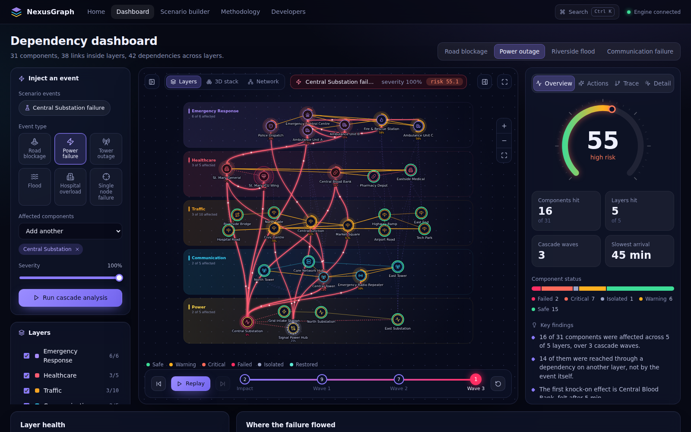
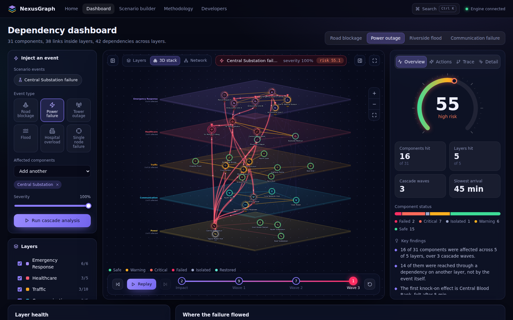
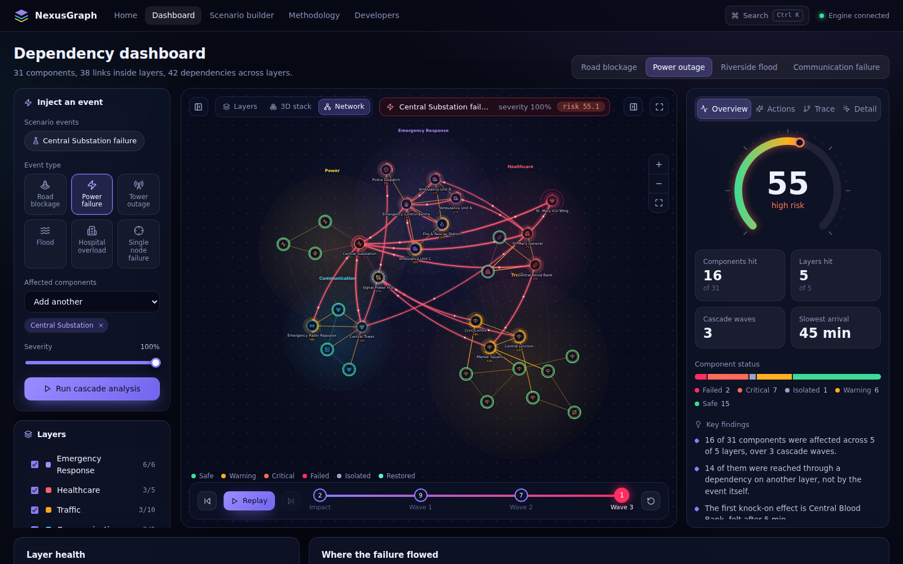
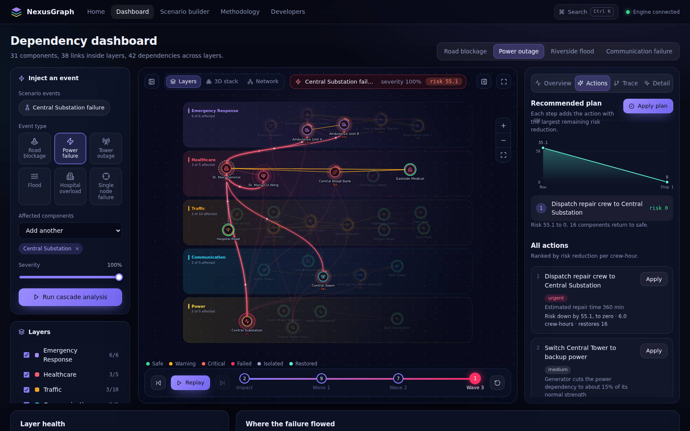
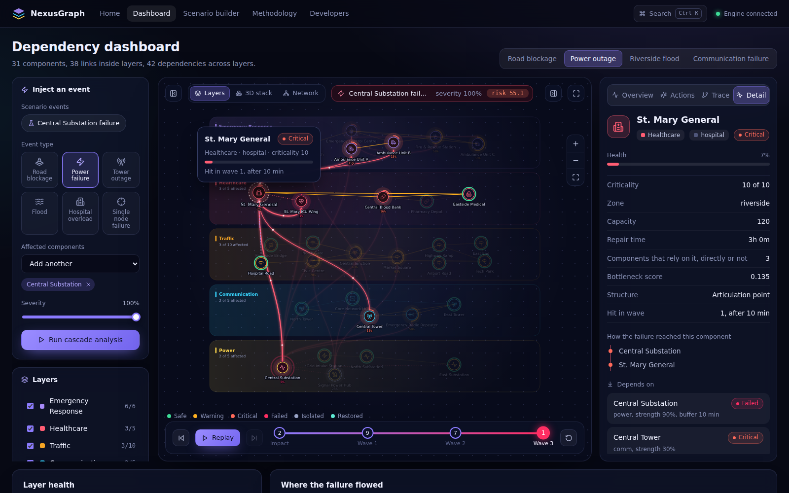

# NexusGraph

**A multi-layer graph decision support system for infrastructure dependency analysis.**

NexusGraph models roads, hospitals, power, communication and emergency response as separate graph layers, joins them with cross-layer dependency links, simulates how a failure in one layer cascades into the others, scores the resulting risk, and recommends corrective actions. Every recommendation is verified by re-running the simulation with that action applied. The engine is built on classic graph algorithms and discrete mathematics, and each one is implemented from scratch and used by the product.



<table>
<tr>
<td></td>
<td></td>
</tr>
<tr>
<td></td>
<td></td>
</tr>
</table>

More in [`assets/`](assets): landing page, replay at wave 1, the insight charts and the scenario builder.

---

## Contents

1. [Problem statement](#problem-statement)
2. [Proposed solution](#proposed-solution)
3. [Features](#features)
4. [Architecture summary](#architecture-summary)
5. [Technology stack](#technology-stack)
6. [Setup and running](#setup-and-running)
7. [Demo scenarios](#demo-scenarios)
8. [Folder structure](#folder-structure)
9. [API summary](#api-summary)
10. [How the algorithms are used](#how-the-algorithms-are-used)
11. [Discrete mathematics mapping](#discrete-mathematics-mapping)
12. [Testing and verification](#testing-and-verification)
13. [Design decisions and assumptions](#design-decisions-and-assumptions)
14. [Future scope](#future-scope)
15. [Project pitch](#project-pitch)

---

## Problem statement

Cities run on infrastructure systems that are planned and monitored separately, yet depend on each other: hospitals need power and road access, cell towers need power, ambulances need roads, hospitals and radio, power substations need remote control over the network. The most damaging failures start in one system and travel along these hidden links. Single-layer tools cannot show that chain, so decision makers see a failure only after it has already spread.

## Proposed solution

Represent each infrastructure as a **graph layer**, connect layers with **weighted dependency relations**, and compute the propagation of an event as a **fixed-point recurrence evaluated in breadth-first waves**. The output is not only a visualisation. It is a causal trace per component, a composite risk score, a ranked list of tested actions, an optimal repair order, and an ambulance dispatch plan.

## Features

**Modelling**
- Five built-in layers (Traffic, Healthcare, Power, Communication, Emergency Response) and an API to add more.
- Nodes with criticality, zone, capacity, repair time, feed flag and physical anchor; weighted edges; dependencies with strength, buffer time and redundancy groups.
- 31-component "Metro City" seed model with 38 edges and 42 cross-layer dependencies.

**Simulation**
- Six event types: road blockage, power failure, tower outage, flood (by zone), hospital overload, single node failure, each with severity.
- Wave-by-wave cascade with arrival times, causal path tracing and per-step history.
- Intra-layer isolation (a component cut off from its feed) plus cross-layer dependency propagation.
- Handles redundant providers and circular dependencies.

**Decision support**
- Risk score 0 to 100 with four explainable components.
- Recommendations ranked by measured risk reduction per crew-hour, a greedy multi-step plan, restoration order, repair batching and crew rotation, and optimal ambulance dispatch.
- N-1 vulnerability screening of every component.
- Apply a plan and see components turn "restored".

**Interface**
- A custom SVG graph renderer with three layouts of the same data: banded **Layers**, an isometric **3D stack** and a force-directed **Network**. Pan and zoom, hover tooltips, click-to-inspect with focus dimming, and a **health ring** around every node.
- Failure is animated: dependency links that carried the failure turn red with particles flowing provider to dependent, newly hit nodes ripple, and a **replay bar** scrubs or plays the cascade wave by wave.
- Insight charts built from scratch in SVG: risk gauge, layer-health radar, **Sankey failure flow** between layers, dependency matrix heatmap, cascade-wave bars, arrival-time timeline, risk-reduction curve and N-1 ranking.
- Plain-language **key findings** generated from each simulation.
- **Ctrl K command palette** (run events, switch scenario or view, jump to any component), toasts, collapsible side rails and a full-screen focus mode.
- **Demo snapshot mode**: if the backend is not running, the dashboard and the landing hero fall back to a baked snapshot of the four scenarios.
- Landing page whose hero is the real product replaying a power outage, scenario builder with click-to-wire preview, methodology page and developer notes.

## Architecture summary

```
React UI (pages, components)  -->  store/NexusContext  -->  services/api.js
                                                              |  HTTP / JSON
FastAPI routes + Pydantic schemas  (app/api)                  v
Workspace application service      (app/services/workspace.py)
   |-- GraphStore      in-memory multi-layer graph, validation
   |-- simulation      cascade engine
   |-- risk            scoring
   |-- recommendations candidate generation, evaluation, planning
   |-- analytics       summaries and N-1 screening
   |-- structure       static analysis (bridges, centrality, closure)
Algorithms (app/algorithms)        pure functions, no domain knowledge
```

Graph logic never lives in the UI. The UI renders what the backend computes and replays the recorded propagation history. See [`docs/ARCHITECTURE.md`](docs/ARCHITECTURE.md) and [`docs/WORKFLOW.md`](docs/WORKFLOW.md).

## Technology stack

| Area | Choice |
|---|---|
| Backend | Python 3.10+, FastAPI, Pydantic v2, Uvicorn |
| Engine | Pure Python, standard library only |
| Data | In-memory graph seeded from `app/data/seed.py` (JSON-serialisable; storage layer is isolated behind `GraphStore`) |
| Frontend | React 18, Vite, React Router, react-icons. The graph view and every chart are custom SVG components; styling is a hand-written CSS design system (tokens, no utility framework) |
| Tests | `unittest` (also runs under pytest), optional networkx cross-validation |

## Setup and running

Requirements: Python 3.10 or newer, Node.js 18 or newer.

**Backend**

```bash
cd backend
python -m venv .venv
source .venv/bin/activate          # Windows: .venv\Scripts\activate
pip install -r requirements.txt
python run.py                      # API on http://127.0.0.1:8000, docs at /docs
```

**Frontend** (in a second terminal)

```bash
cd frontend
npm install
npm run dev                        # http://localhost:5173
```

Vite proxies `/api` to port 8000, so no configuration is needed. To point at another host set `VITE_API_URL`.

**Run the tests**

```bash
cd backend
python -m unittest discover -s tests -t .      # or: pytest
```

## Demo scenarios

All four share the Metro City model. From the home page, each opens the dashboard and runs automatically.

| Scenario | Event | What to watch | Risk |
|---|---|---|---|
| Road blockage | Roads into Hospital Road are blocked | Hospital Road becomes isolated, St. Mary General loses access, its ICU wing and ambulances follow. One cleared road restores everything. | 23.3 moderate |
| Power outage | Central Substation fails | Signal hub is stranded, then hospitals, blood bank, tower, radio repeater and control centre degrade in three waves. | 55.1 high |
| Riverside flood | Whole riverside zone hit at 90% | Bridge, hospital road, hospital, ICU and substation hit at once. All five layers end up affected. | 54.1 high |
| Communication failure | Central tower and radio repeater out | Control centre loses its link, then every field unit loses coordination. | 30.5 moderate |

Suggested 60-second demo: open **Power outage**, press **Replay** on the timeline, click **St. Mary General** to show the causal path, open **Actions**, press **Apply plan** and watch the risk drop to zero.

## Folder structure

```
nexusgraph/
├── README.md
├── DSA_ALGORITHMS.md           every algorithm, where it is used, complexity, examples
├── docs/
│   ├── ARCHITECTURE.md
│   ├── WORKFLOW.md
│   ├── API.md
│   └── FUTURE_SCOPE.md
├── assets/                     screenshot checklist
├── backend/
│   ├── run.py
│   ├── requirements.txt
│   ├── app/
│   │   ├── main.py             app factory, CORS, error handlers
│   │   ├── api/                routes.py, schemas.py
│   │   ├── core/               config.py (model constants), errors.py, state.py
│   │   ├── models/             domain.py (dataclasses)
│   │   ├── algorithms/         graph, traversal, shortest_path, connectivity, mst,
│   │   │                       coloring, centrality, matching, discrete_math
│   │   ├── services/           graph_store, simulation, risk, structure,
│   │   │                       recommendations, analytics, workspace
│   │   ├── data/               seed.py (Metro City and scenario presets)
│   │   └── utils/
│   ├── scripts/export_demo.py  regenerates the frontend demo snapshot
│   └── tests/                  test_algorithms.py, test_simulation.py, test_api.py
└── frontend/
    ├── index.html, vite.config.js
    └── src/
        ├── pages/              Landing, Dashboard, Builder, Methodology, DevNotes
        ├── viz/                NetworkView.jsx (graph renderer), charts.jsx, nodeIcons.js
        ├── components/         panels, replay bar, command palette, toasts, HeroCascade
        ├── store/              NexusContext (live or demo data), PaletteContext
        ├── services/           api.js
        ├── hooks/              useTween, useElementSize
        ├── utils/              layouts.js (bands, isometric, force), graph.js, insights.js
        ├── demo/               demo.json snapshot (generated) and loader
        └── styles/             base, components, viz, pages
```

## API summary

Interactive docs are served at `/docs`. Full reference in [`docs/API.md`](docs/API.md).

| Method and path | Purpose |
|---|---|
| `GET /api/layers`, `POST /api/layers` | List or create layers |
| `POST /api/nodes`, `POST /api/edges` | Add nodes and in-layer edges |
| `POST /api/dependencies` | Add a cross-layer dependency |
| `POST /api/events` | Register an event |
| `POST /api/simulations` | Run the cascade |
| `POST /api/simulations/mitigate` | Re-run with actions applied |
| `GET /api/graph` | Full graph state with structural analysis |
| `GET /api/recommendations` | Ranked actions, plan, schedule, dispatch |
| `GET /api/analytics/summary` | Risk, layer impact, waves, cascade stats |
| `GET /api/analytics/vulnerability` | N-1 screening |
| `GET /api/scenarios`, `POST /api/scenarios/{id}/load` | Demo scenarios |

## How the algorithms are used

| Algorithm | Role in NexusGraph |
|---|---|
| BFS with a queue | Wave-by-wave cascade; reachability from a layer's feed nodes |
| DFS | Circular dependency detection; bridges and articulation points |
| Dijkstra | Detours around blocked roads; ambulance travel times |
| Connected components | Which survivors are cut off |
| Bridges and articulation points | Structural single points of failure; part of the risk score |
| Kruskal MST | Minimum-cost backbone and cycle redundancy per layer |
| Topological sort | Restoration order; propagation DAG |
| Welsh-Powell colouring | Conflict-free repair batches |
| Betweenness centrality | Cross-layer bottleneck weight in risk |
| Hungarian algorithm | Optimal ambulance to hospital assignment |
| Transitive closure | Blast radius of every component |

Details, complexity and worked examples: [`DSA_ALGORITHMS.md`](DSA_ALGORITHMS.md).

## Discrete mathematics mapping

| Concept | Where it appears |
|---|---|
| Graphs | Every layer is G = (V, E); the supra-graph joins layers through dependency links |
| Trees | BFS tree gives the causal path of each affected node; minimum spanning tree per layer |
| Sets | Affected-by-layer sets, cross-layer subset, redundancy groups, union of isolated sets |
| Relations | Dependency is a binary relation; its properties are classified (irreflexive, not symmetric, not transitive) and its transitive closure gives the blast radius |
| Combinatorics and counting | C(31,1)=31, C(31,2)=465, C(31,3)=4495 failure cases; path-count recurrence |
| Graph colouring | Repair actions that touch neighbouring components get different batches |
| Recurrence relations | Health fixed point h(v) = min(...); path count P(v)=ΣP(u); restoration time T(v)=repair+max T(p) |
| Modular arithmetic | Crew for a repair batch is (batch + layer index) mod crews |
| Pigeonhole principle | With a ambulances and h hospitals some hospital receives at least ⌈a/h⌉ units; same for repair crews |
| Connectivity and components | Isolation after failures; independent cycles E - V + C |
| Paths and cycles | Dijkstra paths; cycle detection among dependencies (the seed model contains C1 and P3 depending on each other) |
| Spanning trees | Kruskal on each layer |
| Matching and assignment | Hungarian algorithm for dispatch |

## Testing and verification

- **48 engine and algorithm tests** run with the standard library only (`python -m unittest discover -s tests -t .`). Algorithms are cross-checked against networkx (shortest paths, bridges, articulation points, components, MST weight, betweenness; skipped if networkx is absent) and against brute-force enumeration (Hungarian assignment).
- **Engine invariants** are tested on all four scenarios: the result is a fixed point of the health equation, propagation only moves forward in waves, health never decreases, the greedy plan is reproducible, and risk is monotone in severity.
- **7 HTTP tests** in `tests/test_api.py` cover the full workflow, graph editing and error codes. They run once FastAPI is installed and are skipped otherwise.
- **Timeline replay**: the client-side replay was checked to reproduce the server's final status for every node in every scenario.
- **Frontend, in a real browser**: the actual app was bundled and driven with Playwright in headless Chromium against the real Python engine. Scripted checks cover: all 31 nodes rendering, hover tooltips, node selection and its causal path, replay scrubbing, the command palette, applying a plan and seeing components restored, N-1 screening, focus mode and rail toggles, the full builder workflow (add nodes, wire an edge by clicking in the preview, add a dependency, run a custom event), the offline demo-snapshot fallback, and mobile layouts with no horizontal overflow. The console was error-free in all of them, and these runs caught and fixed several real bugs (a tween that could produce negative chart heights, resize handling in the viewport, pointer events stolen by edges).
- **Not run here**: `npm install` and `vite build` themselves (the sandbox had no network), so the first real install is the final integration check. The test run used esbuild with a small stand-in for React Router.

## Design decisions and assumptions

- **Dependency strengths, buffers and criticalities are modelling inputs**, not measurements. They live in `seed.py` and can be edited in the builder.
- **Health is a dimensionless service level** in [0, 1]. The model is deterministic and does not forecast probabilities.
- **Isolation is judged against the intact graph**, so nodes that were never connected are not reported as cut off.
- **State is in memory** and the API serialises access with a lock, so run a single worker (`python run.py` does). `GraphStore` isolates storage so SQLite or PostgreSQL can replace it.
- Risk weights (0.55, 0.20, 0.15, 0.10) are named constants in `services/risk.py`, chosen for explainability and open to tuning.
- **Custom visualisation instead of chart libraries.** The graph view, Sankey, radar, matrix and timeline are purpose-built SVG components. This allows an isometric stack, health rings, flowing particles and replay that off-the-shelf graph and chart libraries do not offer, and keeps the dependency list to React, a router and an icon set.
- **The demo snapshot is generated, not hand-written.** `python backend/scripts/export_demo.py` re-runs the engine for the four scenarios and writes `frontend/src/demo/demo.json`. Re-run it after changing seed data or the engine.

## Future scope

Live data feeds, probabilistic failure models, time-stepped restoration, persistence, multi-user workspaces, GIS map layer and more. See [`docs/FUTURE_SCOPE.md`](docs/FUTURE_SCOPE.md).

## Project pitch

Cities do not fail one system at a time. NexusGraph is a decision-support framework that treats infrastructure as a graph of graphs, so an operator can ask "what happens if this fails?" and get a traceable, explainable answer in seconds: which components degrade, in what order, how badly, and which action reduces risk the most. The contribution is the combination: a cross-layer dependency model with redundancy and buffers, a convergent cascade recurrence, simulation-verified recommendations, and the discrete mathematics behind each step made visible in the product.
